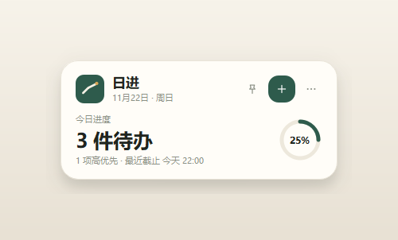
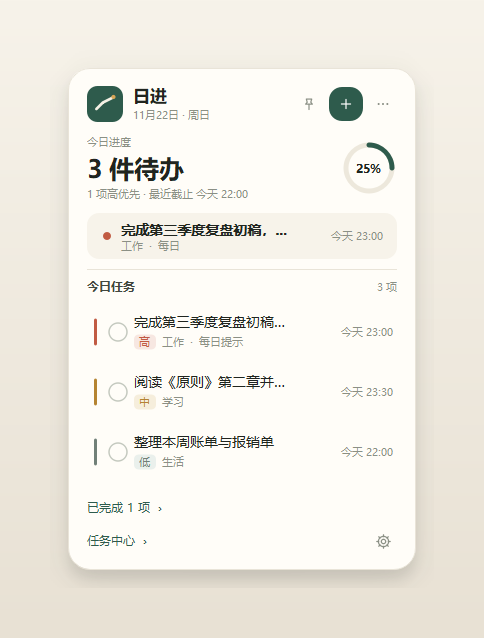
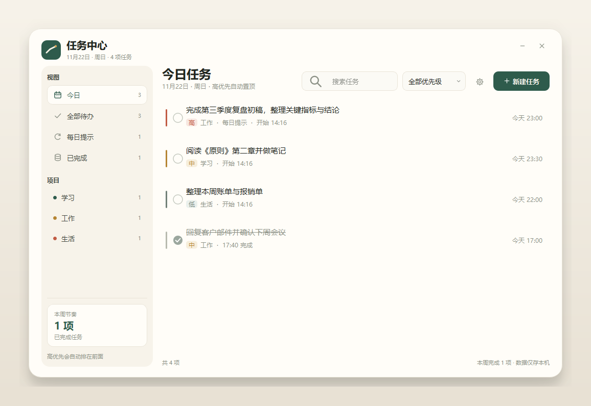

# 日进 · 每日任务进度管理

> 把「今天要做什么」收进一张安静的悬浮卡片里。

一款面向 Windows 的本地优先任务程序：鼠标移过去看细节，完成任务点一下，误触可以撤销。


[](https://github.com/YULIU-GitHub/rijin/actions/workflows/tests.yml)

当前版本：**1.0.1**

<p align="center">
  
  
</p>

<p align="center"><sub>默认只显示今日进度；鼠标悬停后展开任务详情</sub></p>



## 特点

- **轻**：默认是一张可拖动的小卡片，不占任务栏；不用时安静地待在屏幕角落。
- **稳**：SQLite 本地存储，断网可用，不上传任何任务数据。
- **专注**：高优先级自动排前，每日汇总 + 最后提醒，重要的事不会悄悄溜走。
- **可改**：数据层、提醒引擎、界面分层，数据库带版本迁移，方便继续扩展。

## 功能

### 任务生命周期

- 任意时间新建、编辑、删除任务。
- 录入字段：从属项目、任务明细、优先级（高 / 中 / 低）、提醒时间、拟完成时间、每日提示、备注。
- 保存时自动记录任务开始时间；编辑不会重置开始时间。
- 点击任务左侧圆圈完成，系统自动记录完成时间。
- 完成后 6 秒内可点「撤销」；任务中心「已完成」里也可随时撤销。
- 删除任务前二次确认。

### 提醒

- **每日汇总**：默认每天 09:00，可在设置中改成任意时间。汇总今日到期、逾期和「每日提示」任务，高优先级自动排在前面。
- **任务提醒**：到达「提醒时间」时通知一次；勾选「每天在这个时间提示我」的任务会每天提醒。
- **最后提醒**：到达「拟完成时间」时发出「需要完成」提醒。
- 程序重启不会重复提醒已经提醒过的节点；支持托盘通知和悬浮窗自动展开。
- 每日汇总时间、通知开关、自动展开都可以随时调整，立即生效。

### 界面

- 无边框悬浮卡片，可拖动，松手自动吸附屏幕边缘，位置会被记住。
- **收起态只显示标题与今日进度**；鼠标悬停展开任务详情，移开自动收起。
- 图钉按钮固定展开；`⋯` 菜单可快速新建、打开任务中心、设置、隐藏、退出。
- 独立「任务中心」：今日 / 全部待办 / 每日提示 / 已完成，支持项目、优先级、关键词筛选。
- 系统托盘常驻，关闭任务中心或隐藏悬浮窗后仍可唤回。

### 数据

- 开机自启（可在设置中关闭）。
- 每日自动备份数据库，保留最近 14 份。
- 一键导出 JSON 任务数据。
- 单实例运行，重复点击快捷方式只会呼出已有窗口。
- 程序与数据分离：升级/重装程序不会影响任务数据。

## 快速开始

### 环境要求

- Windows 10 / 11
- Python 3.9+
- PyQt5

```powershell
git clone https://github.com/YULIU-GitHub/rijin.git
cd rijin
python -m pip install -r requirements.txt
```

### 安装到本机

在项目目录打开 PowerShell：

```powershell
powershell -ExecutionPolicy Bypass -File .\install.ps1
```

安装脚本会：

1. 将程序复制到 `%LOCALAPPDATA%\Programs\RiJin`；
2. 在桌面和开始菜单创建「日进」快捷方式；
3. 写入当前用户的开机自启；
4. 启动程序。

也可以不安装，直接运行源码：

```powershell
python app.py
```

### 卸载

```powershell
powershell -ExecutionPolicy Bypass -File .\uninstall.ps1
```

默认保留任务数据；加 `-PurgeData` 可一并删除。

更新程序：修改源码后重新运行 `install.ps1` 即可，数据不会受影响。

## 使用

### 新建与编辑

- 点击悬浮窗右上角 `+`，或任务中心「新建任务」。
- 双击任务行编辑；右键任务行有编辑、完成 / 撤销、删除。
- 项目可以直接输入，也可以从已有项目中选择。
- 「提醒时间」用于开始推进；「拟完成时间」是最后提示时间。

### 完成与撤销

- 点任务左侧圆圈完成任务，底部会出现带「撤销」的提示条。
- 任务中心切到「已完成」，鼠标悬停任务行，点撤销图标即可回退。
- 撤销不会重置任务的开始时间。

### 悬浮窗

- 悬停：展开详情；移开：自动收起。
- 拖动顶部：移动位置；松手会吸附屏幕边缘。
- 图钉：固定展开，不再自动收起。
- `⋯`：展开 / 收起、任务中心、新建任务、设置、隐藏到托盘、退出。
- 托盘图标单击 / 双击：呼出悬浮窗；右键有菜单。

### 快捷键

| 位置 | 快捷键 | 作用 |
| --- | --- | --- |
| 任务中心 | `Ctrl+N` | 新建任务 |
| 任务中心 | `Ctrl+F` | 聚焦搜索框 |
| 任务中心 | `Esc` | 隐藏任务中心 |
| 任务行 | `Space` | 完成 / 撤销完成 |
| 任务行 | `Enter` | 编辑任务 |
| 任务行 | `Delete` | 删除任务 |

### 命令行参数

```powershell
python app.py              # 启动悬浮窗
python app.py --center     # 打开任务中心
python app.py --add        # 新建任务
python app.py --settings   # 打开设置
python app.py --debug      # 输出调试日志
python app.py --version    # 显示版本
```

## 数据与隐私

数据只保存在本机：

```text
%APPDATA%\RiJin\
├── rijin.db          # 任务数据库
├── config.json       # 窗口位置、提醒时间等设置
├── backups\          # 每日数据库备份
└── logs\app.log      # 运行日志
```

- 不联网、不上传、不需要账号。
- 任务数据与程序目录分离，重装/升级不会覆盖数据。
- 可在「设置 → 数据」打开数据目录、导出 JSON 或立即备份。

## 项目结构

```text
app.py                  启动、单实例、异常日志
rijin/core/             纯数据与领域逻辑（不依赖界面）
  database.py           SQLite 连接、schema 版本迁移
  repository.py         任务 / 提醒日志 / 状态查询
  models.py             Task 领域模型
  config.py             JSON 配置
  autostart.py          HKCU Run 开机自启
  backup.py             JSON 导出、SQLite 在线备份
rijin/services/
  store.py              任务变更信号
  reminders.py          每日汇总、任务提醒、最后提醒
rijin/ui/
  main_window.py        悬浮窗
  task_center.py        任务中心
  dialogs.py            任务编辑、设置、确认
  widgets.py            自绘任务行、动画、Toast
  theme.py              颜色与 QSS
  icons.py              矢量图标
tests/                  核心、控制器与 UI 冒烟测试
```

提醒引擎只产生结构化事件，不直接操作窗口；控制器再把事件分发给托盘通知和悬浮窗。将来接手机推送、邮件、日历等只需要新增一个消费者。

## 开发

```powershell
# 安装开发依赖
python -m pip install -r requirements.txt -r requirements-dev.txt

# 运行源码版
python app.py --debug

# 测试
python -m pytest -q

# 静态检查
python -m flake8 app.py rijin --max-line-length=110 --ignore=E203,W503,E501
```

调试时可以用 `RIJIN_DATA_DIR` 指向独立数据目录，避免污染正式任务：

```powershell
$env:RIJIN_DATA_DIR = "D:\temp\rijin-dev"
python app.py --debug
```

### 数据迁移

数据库用 `PRAGMA user_version` 管理版本。新增字段时在 `rijin/core/database.py` 的 `_migrate()` 里追加：

```python
if version < 2:
    self.conn.execute("ALTER TABLE tasks ADD COLUMN repeat_rule TEXT")
    self.conn.execute("PRAGMA user_version = 2")
```

旧数据会原样保留。

### 提醒去重

- 任务提醒：`reminder_log(task_id, kind, occurrence)` 唯一键；
- 每日汇总：`app_state.last_digest_date`；
- 程序重启、系统休眠唤醒都不会重复轰炸。

### 主题

颜色、字号、圆角集中在 `rijin/ui/theme.py`。后续要增加深色模式，可以在配置里增加 `theme` 字段，加载不同 QSS 变量。

## 路线图

- 自动重置的循环任务 / 习惯打卡
- 子任务与任务依赖
- 周报、完成趋势统计
- 深色主题
- 多显示器位置记忆

当前「每日提示」表示每天持续提醒，任务完成后即结束；自动循环任务在后续计划中。

## 常见问题

**悬浮窗被其他窗口挡住？**

设置里打开「总在最前」；被隐藏时点击托盘图标或再次运行快捷方式。

**没有收到系统通知？**

Windows 聚焦助手 / 通知设置可能拦截了托盘通知；程序同时会自动展开悬浮窗作为兜底。可在系统「通知」里允许 Python / 日进。

**换了 Python 环境后开不了机自启？**

重新运行 `install.ps1`，会按当前 Python 路径重写自启命令。

**数据在哪里？**

设置 → 数据 → 打开数据目录；或直接访问 `%APPDATA%\RiJin`。

## License

[MIT](LICENSE) © 2026 YULIU-GitHub
